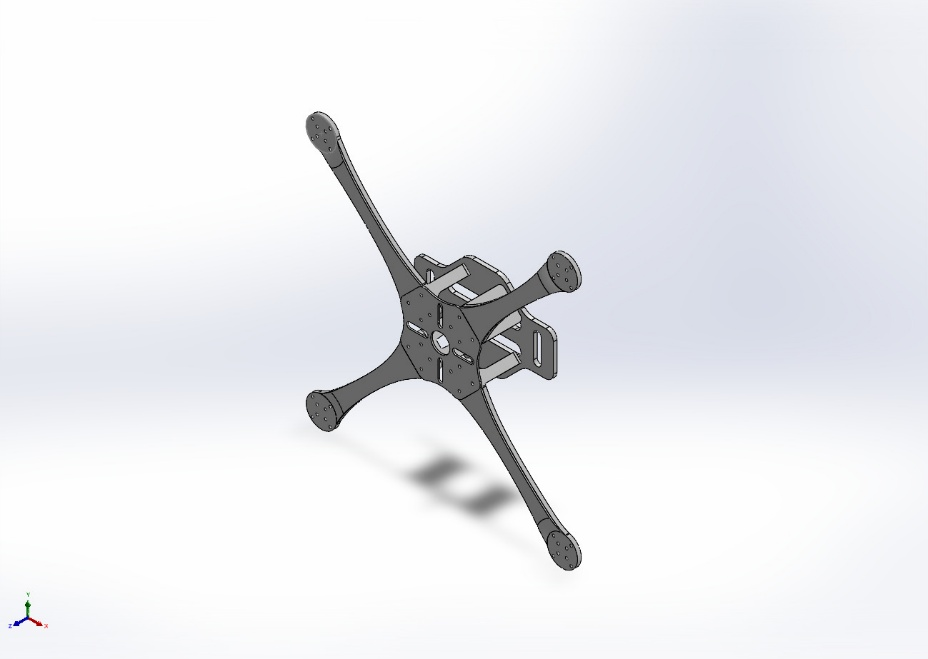
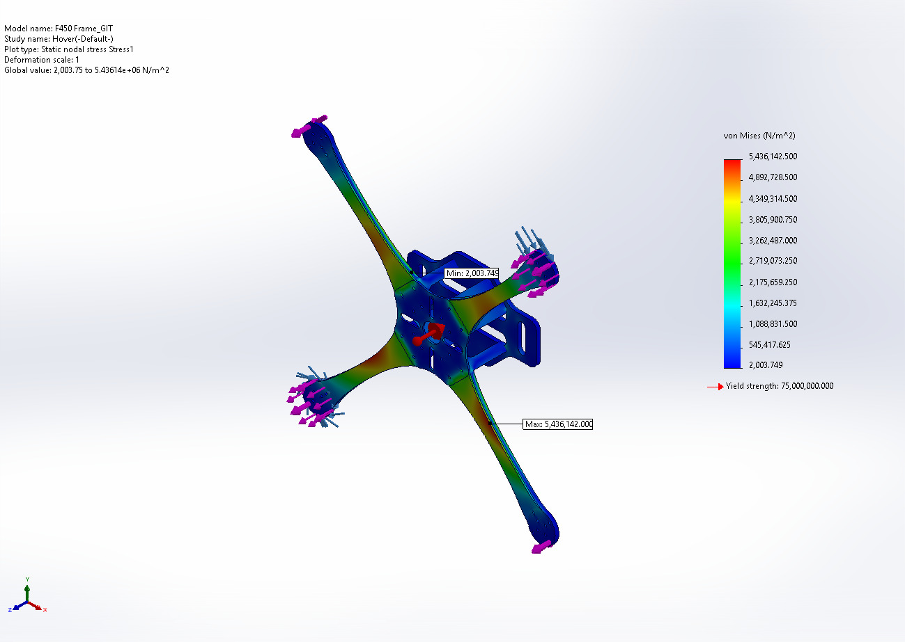
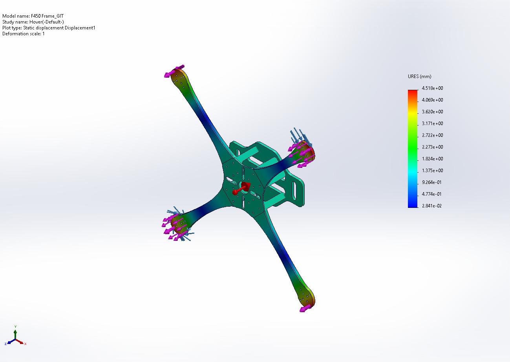

# F450 Frame

A single-session CAD study of an F450-class quadcopter frame: one Fusion 360 archive and one SolidWorks Simulation static report. This is a small design snapshot, not an ongoing research project.

## Objective and contents

The frame was designed as a lightweight, upgradeable platform for a quadcopter. The evidence in this repository is:

| File | What it is |
|---|---|
| `F450 Frame_GIT.f3d` | Fusion 360 archive containing the CAD model (requires Fusion 360 to open) |
| `F450 Frame_GIT-Hover-1.docx` | SolidWorks Simulation report for the "Hover" static study, including the assembly/body table and result plots |
| `renders/`, `analysis/` | Three images exported from the report: frame overview, von Mises stress and displacement |

The Google Drive link previously given in this README pointed to an external walkthrough; the three exported images now make the key visuals available in-repository.

## Assembly structure

The SolidWorks report lists ten solid bodies in PA66 (Nylon 66):

- Top plate (0.0175 kg)
- Base plate (0.0652 kg)
- 4 × Arm Top (≈0.0071 kg each)
- 4 × Arm (≈0.0529 kg each)

Total frame mass is approximately 0.26 kg from the body mass table. Material model: PA66, linear elastic isotropic; E = 3.3 GPa, ν = 0.394, density 1,140 kg/m³, yield strength 75 MPa. Contacts are modelled as globally bonded.

## Static "Hover" study

| Item | Value from report |
|---|---|
| Mesh | Blended curvature-based; 816,806 nodes, 512,380 elements; max aspect ratio 64.119; 99.7 % of elements with aspect ratio < 3 |
| Loads | Gravity 9.81 m/s²; 1.5 kg remote mass on one face; four −10 N normal forces; two 0.25 N·m torques |
| Peak von Mises stress | 5.44 MPa (5.436142 × 10⁶ N/m²) |
| Max resultant displacement | 4.52 mm |
| Yield strength | 75 MPa |
| Solver | Automatic static; thermal effects on (298 K zero-strain); inertial relief on; large displacement off |

The study is a simulation of the frame under the stated loads. No physical test is recorded.

## Design decisions supported by the files

- PA66 was chosen for the frame bodies; the FEA report uses its library material properties.
- The frame is a ten-body assembly with bonded contacts, separated into top, base and four arm pairs.
- The model was created in a single session ("one shot" in the earlier description); the repository contains one CAD snapshot with no iterative design history.

## What is not documented here

- STEP, STL or IGES exports; the `.f3d` requires Fusion 360.
- 2D manufacturing drawings, critical dimensions (wheelbase, arm section, motor-mount pattern) or tolerances.
- Bill of materials for fasteners, motors, propellers, ESCs or batteries; the 1.5 kg remote mass is a placeholder.
- A documented Fusion 360 feature history or design workflow — the DOCX is a SolidWorks Simulation report, not a CAD walkthrough.
- Assembly mates/joints beyond the bonded FEA contact definition.

These gaps must be filled from the native CAD before the frame can be manufactured from this repository alone.
